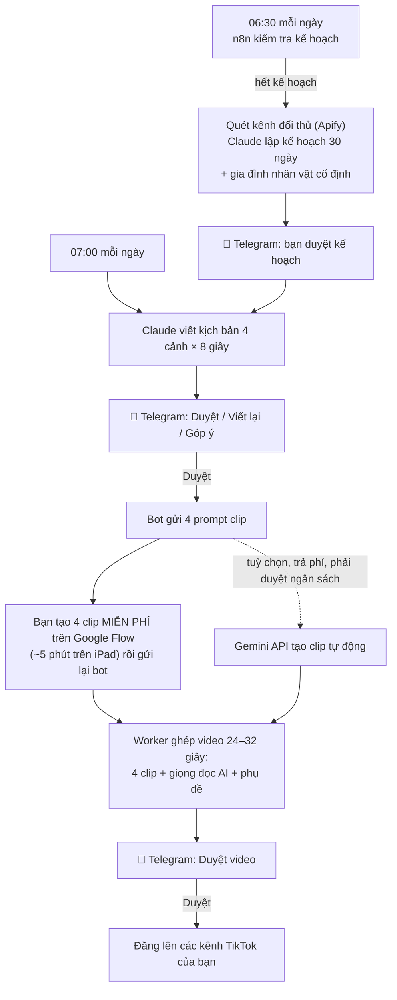

# 📱 Hướng dẫn xây dựng hệ thống TikTok tự động — làm hoàn toàn trên iPad

Tài liệu này dành cho người mới bắt đầu. Bạn chỉ cần **iPad + Safari + vài ứng dụng miễn phí**, không cần laptop.
Làm lần lượt từ Bước 1 đến Bước 10. Tổng thời gian lần đầu: khoảng **1,5–2 giờ**.

---

## 0. Hệ thống làm gì?



**Ba thành phần chạy trên 1 máy chủ ảo (VPS):**

| Thành phần | Vai trò |
|---|---|
| **n8n** | "Bộ não điều phối": hẹn giờ mỗi ngày, nhận/gửi tin Telegram, gọi các bước. Bạn xem được mọi lần chạy trên giao diện web. |
| **worker** (Python, có sẵn trong dự án) | Gọi Claude viết kế hoạch/kịch bản, kiểm soát ngân sách, nhận clip, ghép video bằng FFmpeg, giọng đọc edge-tts, đăng TikTok. |
| **Caddy** | Tạo HTTPS miễn phí để Telegram và TikTok gửi dữ liệu về được. |

### Chi phí — điều quan trọng cần biết trước

| Hạng mục | Chi phí | Ghi chú |
|---|---|---|
| Google Flow (tạo clip AI 8 giây) | **$0** | Có lượt miễn phí mỗi ngày, đủ khoảng 4 clip. **Không có API miễn phí** nên bước này bạn bấm tay ~5 phút/ngày. Tự động hoá trang web Flow vi phạm điều khoản Google, dễ bị khoá tài khoản nên hệ thống không làm. |
| Giọng đọc (edge-tts), ghép video (FFmpeg), phụ đề, n8n, Telegram | **$0** | |
| Apify (quét đối thủ) | **$0** | Gói Free tặng ~5 USD/tháng, đủ dùng. |
| **Claude API** | **~2–5 USD/tháng** | **Bắt buộc** — không có gói miễn phí. Phải nạp tối thiểu 5 USD. Bot sẽ **xin bạn duyệt** trước khi dùng. |
| **VPS** | $0 (Oracle Free) hoặc ~4–6 USD/tháng | Xem Bước 4. |
| Gemini API (clip tự động) | ~0,19 USD/clip → ~0,8 USD/video | **Tuỳ chọn.** Chỉ chạy khi bạn bấm và duyệt ngân sách. |

**Cơ chế duyệt ngân sách:** mọi dịch vụ trả phí đều có hạn mức tháng (`budget` trong `config.yaml`). Khi sắp vượt,
bot gửi tin "💰 Yêu cầu duyệt ngân sách" kèm số tiền và lý do. **Chưa bấm ✅ Duyệt thì hệ thống không tiêu đồng nào.**
Gõ `/ngansach` bất kỳ lúc nào để xem đã tiêu bao nhiêu.

---

## Bước 1. Cài ứng dụng trên iPad (5 phút)

Mở **App Store**, cài:

1. **Telegram** — nơi bạn duyệt kịch bản, gửi clip, duyệt video.
2. **Termius** (miễn phí) — để gõ lệnh vào VPS (SSH).
3. *(Tuỳ chọn)* **Claude** — để hỏi khi gặp lỗi; và dùng **Claude Code trên web** (claude.ai/code) để sửa dự án (Bước 10).

Bạn cũng cần: 1 tài khoản Google (cho Google Flow), 1 thẻ Visa/Mastercard (nạp Claude API; VPS Oracle cũng cần thẻ để xác minh).

---

## Bước 2. Tạo bot Telegram (5 phút)

1. Mở Telegram, tìm **@BotFather** (có dấu tích xanh) → bấm **Start**.
2. Gõ `/newbot` → đặt tên hiển thị (vd `Trợ lý Tuổi Thơ`) → đặt username kết thúc bằng `bot` (vd `tuoitho8x9x_bot`).
3. BotFather trả về **token** dạng `7123456789:AAH...`. Chạm giữ → **Sao chép** → dán tạm vào app **Ghi chú**.
   ⚠️ Token như mật khẩu — không gửi cho ai.

> Nếu bạn từng chạy bot Python cũ của dự án: dùng **chính token cũ** được, script cài đặt sẽ tự tắt bot cũ.

---

## Bước 3. Lấy các khoá API (15 phút)

### 3.1 Claude API (bắt buộc)
1. Safari → **console.anthropic.com** → đăng ký/đăng nhập.
2. **Settings → Billing** → nạp **5 USD** (tối thiểu).
3. **API Keys → Create Key** → đặt tên `tiktok-agent` → sao chép khoá `sk-ant-...` vào Ghi chú.
4. *(Khuyên dùng)* **Settings → Limits** → đặt giới hạn chi tiêu tháng (vd 10 USD) — lớp bảo vệ thứ hai ngoài cơ chế duyệt của bot.

### 3.2 Apify (nên có, miễn phí)
1. **console.apify.com** → đăng ký gói **Free**.
2. **Settings → API & Integrations** → sao chép **Personal API token**.

### 3.3 Pixabay (tuỳ chọn, miễn phí) — video dự phòng khi thiếu clip
**pixabay.com/api/docs** → đăng nhập → kéo xuống phần *Parameters*, khoá nằm ở dòng `key`.

> Khoá TikTok làm ở Bước 8 (cần tên miền của VPS trước).

---

## Bước 4. Thuê VPS (20–30 phút)

Cần: **Ubuntu 24.04** (hoặc 22.04), **≥ 2 GB RAM**, **≥ 30 GB ổ đĩa**. Chọn **một** trong hai cách:

### Cách A — Oracle Cloud Always Free ($0, khó hơn một chút)
1. Safari → **oracle.com/cloud/free** → đăng ký (cần thẻ để xác minh; theo chính sách hiện tại gói Always Free không trừ tiền, chính sách có thể thay đổi).
2. Menu ☰ → **Compute → Instances → Create instance**:
   - **Image:** Canonical Ubuntu 24.04
   - **Shape:** *Ampere* `VM.Standard.A1.Flex` — 2 OCPU, 12 GB RAM (nằm trong hạn mức miễn phí). Nếu báo hết chỗ ("Out of capacity"), thử lại sau vài giờ hoặc chọn vùng khác.
   - **Add SSH keys:** chọn **Generate a key pair for me** → bấm **Save private key** (file `.key` lưu vào app **Tệp**).
   - Bấm **Create**. Đợi trạng thái **Running**, ghi lại **Public IP address**.
3. **Mở cổng 80 và 443** (bắt buộc với Oracle): trên trang instance → mục **Primary VNIC** → bấm vào **Subnet** → **Security Lists** → **Default Security List** → **Add Ingress Rules**:
   - Source CIDR `0.0.0.0/0`, IP Protocol `TCP`, Destination Port Range `80,443` → **Add**.
   (Phần tường lửa bên trong máy, script cài đặt tự mở.)
4. Tên đăng nhập SSH: `ubuntu`.

### Cách B — VPS trả phí ~4–6 USD/tháng (dễ nhất)
Ví dụ Hetzner (CX22), Vultr, DigitalOcean. Tạo máy **Ubuntu 24.04**, 2 GB RAM trở lên, chọn đăng nhập bằng **mật khẩu root** (dễ nhất trên iPad).
Ghi lại **IP** và **mật khẩu**. Tên đăng nhập: `root`.

> Đây là chi phí bạn tự chọn trả trực tiếp cho nhà cung cấp; bot không quản lý khoản này.

---

## Bước 5. Kết nối vào VPS bằng Termius (10 phút)

1. Mở **Termius** → **Hosts** → **+** → **New Host**:
   - **Hostname:** IP của VPS
   - **Username:** `ubuntu` (Oracle) hoặc `root` (VPS khác)
   - **Password** (Cách B) — hoặc **Key** (Cách A): bấm **Keys → +** → **Import from file** → chọn file `.key` đã lưu.
2. Bấm vào host vừa tạo để kết nối → chọn **Continue/Trust** khi hỏi về fingerprint.
3. Thấy dấu nhắc lệnh như `ubuntu@...:~$` là thành công.

> Không dùng được Termius? Oracle có **Cloud Shell** / **Console connection** ngay trong Safari; Hetzner/Vultr có nút **Console** trên web.

**Mẹo gõ lệnh trên iPad:** sao chép lệnh trong hướng dẫn này (chạm giữ → Sao chép) rồi chạm giữ trong Termius → **Paste**.

---

## Bước 6. Cài toàn bộ hệ thống bằng 1 lệnh (10–15 phút)

Trong Termius, dán **lần lượt** 2 lệnh:

```bash
sudo -i
```

```bash
curl -fsSL https://raw.githubusercontent.com/sinhtd1503-png/Claude--code-lab/main/deploy/install.sh | bash
```

Script sẽ hỏi từng khoá — dán các giá trị đã lưu ở Bước 2–3 rồi **Enter** (khoá tuỳ chọn có thể Enter để bỏ qua):

```
  Token bot Telegram (từ @BotFather): 7123456789:AAH...
  Claude API key (console.anthropic.com, bắt đầu bằng sk-ant-): sk-ant-...
  Apify token (quét đối thủ) (Enter để bỏ qua): apify_api_...
  TikTok Client Key (Enter để bỏ qua):            ← Enter (làm ở Bước 8)
  ...
```

Script tự làm: cài Docker, tải code về `/opt/tiktok-agent`, tạo mật khẩu nội bộ, tạo tên miền miễn phí
dạng `158-101-1-2.sslip.io` trỏ về VPS, xin chứng chỉ HTTPS, nạp workflow vào n8n, đăng ký webhook Telegram.
Cuối cùng in ra:

```
✅ XONG!
   • Giao diện n8n:  https://158-101-1-2.sslip.io
   • Mở Telegram, gửi /start cho bot → bot trả lời Chat ID.
```

---

## Bước 7. Khoá bot chỉ cho riêng bạn + mở n8n (5 phút)

1. Telegram → mở bot của bạn → gửi `/start`. Bot trả lời: **Chat ID của bạn là `123456789`**.
2. Quay lại Termius, gõ:
   ```bash
   cd /opt/tiktok-agent && nano .env
   ```
   Dùng phím mũi tên tìm dòng `TELEGRAM_CHAT_ID=` → gõ số Chat ID vào sau dấu `=`.
   Lưu: **Ctrl + O**, **Enter**, thoát: **Ctrl + X**. (Bàn phím iPad: Termius có thanh phím Ctrl phía trên bàn phím ảo.)
3. Chạy lại lệnh cài để áp dụng (nhanh hơn lần đầu):
   ```bash
   bash deploy/install.sh
   ```
4. Từ giờ bot **chỉ nhận lệnh từ bạn**. Gửi `/start` → bot hiện danh sách lệnh.
5. Safari → mở địa chỉ n8n đã in ra → tạo tài khoản quản trị (email + mật khẩu mạnh). Bạn sẽ thấy workflow
   **"TikTok Agent – Telegram duyệt bài"** đang bật (Active). Không cần sửa gì. Tab **Executions** cho xem lịch sử từng lần chạy.

---

## Bước 8. Kết nối TikTok để tự động đăng (20–30 phút)

1. Safari → **developers.tiktok.com** → đăng nhập → **Manage apps → Connect an app** (tạo app).
2. Điền thông tin app. Phần **Terms of Service URL** và **Privacy Policy URL** dùng trang có sẵn của dự án:
   `https://sinhtd1503-png.github.io/Claude--code-lab/`
3. **Add products:** thêm **Login Kit** và **Content Posting API**.
4. **Login Kit → Redirect URI:** dán `https://<tên-miền-của-bạn>/tiktok/callback`
   (đúng địa chỉ script in ra ở dòng "Link kết nối TikTok").
5. **Scopes:** bật `user.info.basic`, `video.upload`, `video.publish`.
6. Khi app chưa được TikTok duyệt, vào **Sandbox** → thêm **Target users** là các tài khoản TikTok của bạn.
7. Sao chép **Client key** và **Client secret** → Termius:
   ```bash
   cd /opt/tiktok-agent && nano .env      # điền TIKTOK_CLIENT_KEY= và TIKTOK_CLIENT_SECRET=
   bash deploy/install.sh
   ```
8. **Nhiều kênh TikTok:** sửa danh sách kênh (đặt tên không dấu, không cách):
   ```bash
   nano config.yaml        # tìm mục accounts:, vd:  - "kenh_chinh"   - "kenh_phu"
   docker compose restart worker
   ```
9. Telegram → gửi `/tiktok` → bot gửi link cho từng kênh. Mở link bằng Safari, **đăng nhập đúng tài khoản** → **Cho phép**.
   Trang báo "✅ Đã kết nối". Kết nối kênh tiếp theo: đăng xuất TikTok trên Safari rồi mở link kế tiếp.
   Gõ `/trangthai` để kiểm tra (✅ = đã kết nối).

**Lưu ý về chính sách TikTok:**
- Mặc định `post_mode: "inbox"`: video được đẩy vào **hộp nháp** trong app TikTok; bạn mở app, dán caption bot gửi, bấm Đăng (10 giây/video). Cách này dùng được ngay.
- `post_mode: "direct"` (đăng thẳng): chỉ đăng **công khai** được sau khi app qua **audit** của TikTok; trước đó video chỉ ở chế độ riêng tư.
- Đăng **cùng một video** lên nhiều kênh có thể bị TikTok giảm phân phối — cân nhắc.

---

## Bước 9. Chạy thử lần đầu (30 phút)

1. Telegram → gửi `/kehoach`.
2. Bot gửi **💰 Yêu cầu duyệt ngân sách** cho Claude (~5 USD/tháng) → bấm **✅ Duyệt**.
3. 2–5 phút sau bot gửi **🗓 Kế hoạch 30 ngày**: gia đình nhân vật cố định + lịch 30 chủ đề.
   - Đồng ý → **✅ Duyệt kế hoạch**.
   - Muốn sửa → **Trả lời (Reply)** tin nhắn kế hoạch (chạm giữ tin → Trả lời) và gõ góp ý, vd "thêm chủ đề Tết, bớt chủ đề trường học".
4. Gửi `/nhanvat` → bot gửi mô tả nhân vật + **prompt tạo ảnh nhân vật chuẩn**. Làm 1 lần:
   chạm vào khung prompt (tự sao chép) → tạo ảnh trên Google Flow/Gemini → lưu ảnh đẹp nhất vào **Ảnh**.
5. Gửi `/kichban` (hoặc chờ 07:00 sáng mai) → bot gửi **📝 Kịch bản** 4 cảnh.
   **✅ Duyệt kịch bản** / **🔄 Viết bản khác** / **❌ Bỏ** — hoặc Reply để góp ý cụ thể. Bot ghi nhớ góp ý cho các kịch bản sau.
6. Duyệt xong, bot gửi **4 prompt** (mỗi cảnh 1 tin). Tạo clip — xem mục **"Tạo clip trên iPad"** ngay dưới.
7. Gửi đủ 4 clip → bot báo "Đang ghép video" → 1–3 phút sau gửi **🎞 Video** (~28 giây, có giọng đọc + phụ đề).
8. **✅ Duyệt & đăng TikTok** → bot đăng lên các kênh đã kết nối. **🔁 Thay clip** nếu muốn đổi clip.

### 🎬 Tạo clip trên iPad với Google Flow (≈5 phút/ngày, miễn phí)

1. Safari → **labs.google/flow** → đăng nhập Google → tạo **New project**.
   (Nếu trang báo không hỗ trợ: bấm **aA** trên thanh địa chỉ → **Yêu cầu trang web cho máy tính**.)
2. Trên Telegram, **chạm vào khung prompt cảnh 1** → prompt tự sao chép.
3. Trong Flow: chọn chế độ tạo video, **dán prompt**, chọn tỉ lệ **dọc 9:16**, thêm **ảnh nhân vật** vào mục *Ingredients* (giúp nhân vật giống nhau) → **Tạo**.
4. Clip xong → bấm **Tải xuống** → lưu vào **Ảnh** hoặc **Tệp**.
5. Telegram → **chạm giữ tin "Cảnh 1"** → **Trả lời** → biểu tượng 📎 → chọn clip → Gửi.
6. Bot trả lời "đã nhận cảnh 1 (1/4)" và gửi **khung hình cuối của cảnh 1**. Với cảnh 2, nếu Flow có chế độ
   *Frames to Video*, dùng ảnh này làm **khung bắt đầu** để hai cảnh nối liền mạch.
7. Lặp lại cho cảnh 2, 3, 4. *(Cách nhanh: tạo xong cả 4 clip rồi gửi một lượt theo đúng thứ tự cảnh 1→4.)*

> Bot chỉ tải được clip **≤ 20 MB** (giới hạn của Telegram). Clip 8 giây của Flow thường nhỏ hơn mức này.
> Hết lượt miễn phí trong ngày? Làm tiếp vào hôm sau — bot vẫn chờ. Gõ `/clip` để bot gửi lại các prompt.
> Không muốn tạo tay: nếu bạn điền `GEMINI_API_KEY` vào `.env`, bot hiện thêm nút **🤖 Tạo tự động (≈ $0.76)** — bấm sẽ hỏi duyệt ngân sách trước.

---

## Bước 10. Dùng Claude để sửa/nâng cấp dự án ngay trên iPad

1. Safari → **claude.ai/code** → kết nối GitHub → chọn repo **Claude--code-lab**.
2. Gõ yêu cầu bằng tiếng Việt, ví dụ:
   - "Đổi giọng đọc sang giọng nam"
   - "Thêm kênh đối thủ abc123 vào config.yaml"
   - "Cho bot gửi kịch bản lúc 6 giờ sáng"
3. Claude sửa code và tạo Pull Request → bạn xem và bấm **Merge** trên GitHub.
4. Cập nhật lên VPS: Termius →
   ```bash
   cd /opt/tiktok-agent && bash deploy/install.sh
   ```
   Nếu thay đổi nằm trong file workflow n8n (`n8n/workflows/tiktok-agent.json`), chạy:
   `UPDATE_WORKFLOW=1 bash deploy/install.sh` (lệnh này **ghi đè** các chỉnh sửa bạn làm tay trong giao diện n8n).

**Những thứ thường muốn chỉnh:**

| Muốn đổi | Ở đâu |
|---|---|
| Giờ gửi kịch bản / kiểm tra kế hoạch | Giao diện n8n → mở workflow → node "07:00 – gửi kịch bản" / "06:30 – kiểm tra kế hoạch" → sửa Cron (vd `0 6 * * *` = 6:00) → **Save** + **Publish** |
| Kênh đối thủ, giọng đọc, số cảnh (3 cảnh ≈ 24 giây), ngân sách, kênh TikTok | `config.yaml`, rồi `docker compose restart worker` |
| Khoá API | `.env`, rồi `bash deploy/install.sh` |

---

## 📋 Danh sách lệnh Telegram

| Lệnh | Tác dụng |
|---|---|
| `/kehoach` | Lập kế hoạch 30 ngày mới (tự chạy khi kế hoạch cũ còn ≤ 2 ngày) |
| `/kichban` | Viết ngay kịch bản tiếp theo (bình thường bot tự gửi 07:00) |
| `/clip` | Gửi lại prompt của video đang chờ clip |
| `/nhanvat` | Xem nhân vật cố định + prompt ảnh nhân vật |
| 📷 Gửi ảnh + chú thích | Đặt nhân vật theo ảnh mẫu, vd chú thích `Bé Na - con gái út 8 tuổi` |
| `/nhac` | Thư viện nhạc nền; gửi file mp3/m4a vào chat để thêm |
| `/phongcach` | Xem/sửa mô tả phong cách kênh mẫu (`/phongcach` + mô tả mới) |
| `/trangthai` | Kế hoạch, video đang chờ, kênh TikTok đã kết nối |
| `/ngansach` | Chi phí tháng này của từng dịch vụ |
| `/tiktok` | Lấy link kết nối tài khoản TikTok |

## 🛠 Lệnh quản trị VPS (gõ trong Termius sau `sudo -i` và `cd /opt/tiktok-agent`)

| Việc | Lệnh |
|---|---|
| Xem tình trạng các dịch vụ | `docker compose ps` |
| Xem log worker (lỗi Claude, ghép video, TikTok) | `docker compose logs -f --tail 100 worker` (thoát: Ctrl+C) |
| Xem log n8n | `docker compose logs -f --tail 100 n8n` |
| Khởi động lại tất cả | `docker compose restart` |
| Cập nhật code mới từ GitHub | `bash deploy/install.sh` |
| Sao lưu dữ liệu (kế hoạch, kịch bản, token TikTok) | `tar czf ~/backup-$(date +%F).tgz data .env config.yaml` |

## 🆘 Xử lý sự cố

| Hiện tượng | Cách xử lý |
|---|---|
| Bot không trả lời | `docker compose ps` xem 3 dịch vụ có *running*; chạy lại `bash deploy/install.sh` (đăng ký lại webhook). Mở n8n → **Executions** xem lần chạy lỗi ở node nào. |
| Script báo "Chưa vào được https://…" | Chưa mở cổng 80/443 trên trang quản lý VPS (Bước 4, Cách A mục 3). Mở xong chạy lại script. |
| Bot báo "⚠️ n8n không gọi được worker" | `docker compose logs --tail 50 worker` để xem lỗi; thường do sai khoá trong `.env`. |
| "Chưa có kế hoạch" / không thấy kịch bản 07:00 | Kế hoạch đang chờ bạn duyệt, hoặc yêu cầu ngân sách chưa được duyệt. Gõ `/trangthai`. |
| Lỗi giọng đọc "No audio was received" | Dịch vụ giọng đọc miễn phí chập chờn. Bấm **🔁 Thử lại** trên tin báo lỗi sau vài phút. |
| Clip gửi lên báo lỗi tải file | Clip > 20 MB. Tải clip ở chất lượng thấp hơn (720p) rồi gửi lại. |
| Đăng TikTok lỗi `scope`/`token` | Gõ `/tiktok` và kết nối lại tài khoản. Kiểm tra tài khoản đã được thêm vào Sandbox (Bước 8.6). |
| Muốn tắt hẳn hệ thống | `docker compose down` (dữ liệu vẫn giữ trong `data/`). |

## 🔒 Bảo mật

- Khoá API chỉ nằm trong `/opt/tiktok-agent/.env` trên VPS (quyền 600) — không có trong GitHub.
- Bot chỉ nhận lệnh từ `TELEGRAM_CHAT_ID` của bạn; webhook Telegram có mã bí mật riêng.
- Worker không mở ra Internet (chỉ n8n gọi được, có mật khẩu nội bộ); riêng đường dẫn `/tiktok/callback` công khai để TikTok trả token về.
- Đặt mật khẩu mạnh cho tài khoản n8n. Đừng chia sẻ địa chỉ n8n công khai.
