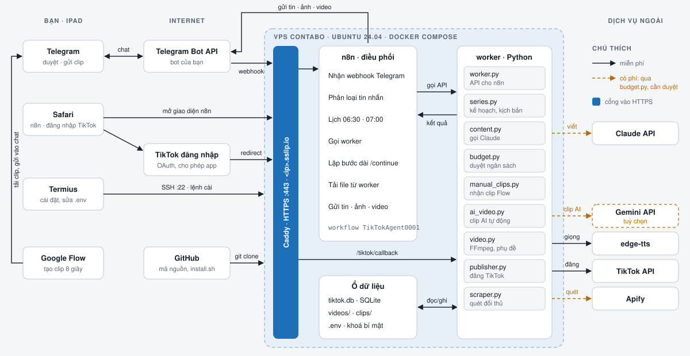
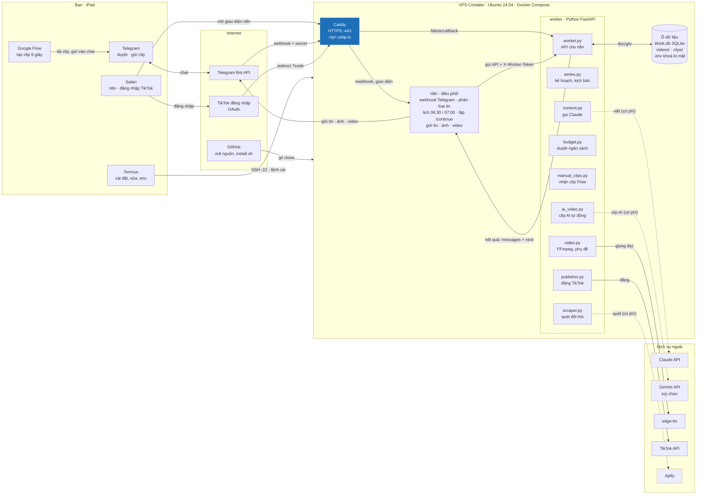
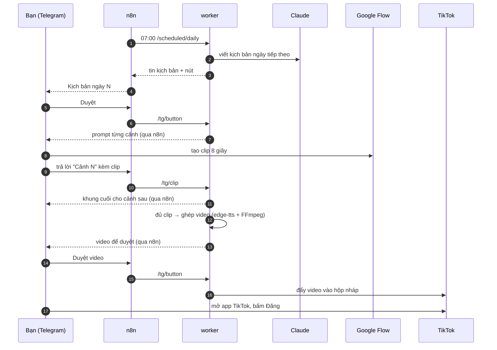

# Phương án xử lý — TikTok Content Agent

_Cập nhật: 11/11/2026_

Tài liệu tổng hợp toàn bộ giải pháp: bài toán, kiến trúc, luồng xử lý, các kết nối, chi phí, bảo mật và cách triển khai.
Hướng dẫn thao tác từng bước xem `CAI_DAT_CONTABO.md`; tiến độ xem `TIEN_DO.md`.

---

## 1. Bài toán

Xây hệ thống tự động làm nội dung cho các kênh TikTok chủ đề **tuổi thơ 8x 9x, nề nếp gia đình, lễ phép, chân – thiện – mỹ**,
luôn tích cực và giáo dục. Yêu cầu:

1. Quét kênh đối thủ, học vì sao video của họ viral
2. Viết kịch bản cho 30 ngày
3. Mỗi ngày gửi kịch bản qua Telegram để duyệt
4. Sau khi duyệt: tạo 3–4 clip AI 8 giây, nhân vật và bối cảnh nhất quán
5. Tự ghép thành video 24–32 giây có giọng đọc và phụ đề
6. Gửi video qua Telegram để duyệt
7. Duyệt xong thì đăng lên một hoặc nhiều kênh TikTok

**Ràng buộc:** dựng và vận hành hoàn toàn trên **iPad** (không laptop); ưu tiên công cụ **miễn phí**; mọi khoản trả phí phải
**báo cáo và được duyệt** trước khi tiêu; hướng dẫn cho người mới.

## 2. Tổng quan giải pháp

```
                         ┌──────────── VPS Contabo (Ubuntu 24.04, Docker Compose) ────────────┐
 Telegram (iPad) ◄─────► │ Caddy (HTTPS sslip.io) ──► n8n (lịch, nhận/gửi Telegram, điều phối) │
                         │        │                         │                                  │
 TikTok OAuth ──────────►│        └── /tiktok/callback ──►  worker (Python FastAPI)            │
                         │                                   ├─ Claude API: kế hoạch, kịch bản │
                         │                                   ├─ Apify: quét đối thủ            │
                         │                                   ├─ FFmpeg + edge-tts: dựng video  │
                         │                                   ├─ SQLite: dữ liệu + ngân sách    │
                         │                                   └─ TikTok Content Posting API     │
                         └────────────────────────────────────────────────────────────────────┘
 Google Flow (tay, miễn phí) ── tạo clip 8 giây ──► gửi vào Telegram ──► worker nhận clip
```

### Hình kiến trúc hệ thống



- File hình: [`docs/kien-truc.svg`](docs/kien-truc.svg) (bấm vào để xem cỡ lớn, phóng to được trên iPad)
- Trang sơ đồ đầy đủ (kèm luồng một ngày và bảng kết nối, chỉ chủ tài khoản Claude mở được):
  https://claude.ai/artifact/2NMpGtRaTb2jqhNrkzbAtk

### Sơ đồ kiến trúc chi tiết



**Cách đọc sơ đồ:**
- Mọi thứ từ Internet vào VPS đều đi qua **Caddy** (HTTPS).
- **n8n** là nơi duy nhất nói chuyện với Telegram; **worker** là nơi duy nhất gọi Claude, Apify, TikTok, Gemini.
- Đường **nét đứt** là dịch vụ có phí: worker hỏi `budget.py` trước, vượt hạn mức thì bot xin bạn duyệt trên Telegram.
- worker chỉ nằm trong mạng nội bộ Docker (`http://worker:8000`), không mở ra Internet.

### Luồng một ngày



### Các kết nối và cách bảo vệ

| Từ | Đến | Đường đi | Bảo vệ |
|---|---|---|---|
| Telegram Bot API | n8n | `https://<ip>.sslip.io/webhook/telegram` qua Caddy | Secret token trong header; chỉ nhận lệnh từ Chat ID của bạn |
| n8n | Telegram Bot API | HTTPS ra ngoài | Token bot trong `.env` |
| n8n | worker | Mạng nội bộ Docker `http://worker:8000` | Header `X-Worker-Token` |
| TikTok đăng nhập | worker | `/tiktok/callback` qua Caddy | Mã `state` dùng một lần |
| worker | Claude, Apify, Gemini | HTTPS ra ngoài | Khoá trong `.env`; cổng duyệt ngân sách |
| worker | TikTok API | HTTPS, upload file video | Token riêng từng kênh trong SQLite |
| Bạn (Safari) | n8n | `https://<ip>.sslip.io` | Tài khoản quản trị n8n |
| Bạn (Termius) | VPS | SSH cổng 22 | Mật khẩu root Contabo |

### Vai trò từng thành phần

| Thành phần | Vai trò | Vì sao chọn |
|---|---|---|
| **n8n** 2.44.6 | Lịch chạy 06:30 / 07:00, nhận webhook Telegram, gửi tin/ảnh/video, gọi worker | Theo yêu cầu; xem và chỉnh luồng trực quan trên iPad |
| **worker** (`tiktok_agent/worker.py`) | Toàn bộ logic: Claude, ngân sách, nhận clip, ghép video, đăng TikTok | Logic phức tạp viết bằng Python để kiểm thử được |
| **Caddy** 2.8.4 | HTTPS tự động, định tuyến | Chứng chỉ miễn phí, không cần mua tên miền (dùng `<ip>.sslip.io`) |
| **Claude Opus 5.5** | Lập kế hoạch 30 ngày, series bible, kịch bản, prompt clip | Viết tiếng Việt tốt; bật fallback phía server |
| **Google Flow** | Tạo clip AI 8 giây | Miễn phí; không có API nên tạo tay |
| **edge-tts** | Giọng đọc `vi-VN-HoaiMyNeural` | Miễn phí, giọng Việt tự nhiên |
| **FFmpeg** | Ghép clip, chèn giọng đọc, phụ đề | Miễn phí, chạy trong Docker |
| **Apify** | Quét kênh đối thủ | Có hạn mức miễn phí $5/tháng |
| **Telegram bot** | Giao diện duyệt duy nhất của chủ kênh | Dùng tốt trên iPad, có nút bấm |

## 3. Luồng xử lý chi tiết

### 3.1 Kế hoạch 30 ngày (`series.py`)
1. `/kehoach` (hoặc tự động 06:30 khi kế hoạch còn ≤ 2 ngày).
2. Kiểm tra ngân sách Claude/Apify → quét đối thủ → Claude tạo:
   - **Series bible:** một gia đình nhân vật cố định (tên, tuổi, ngoại hình, trang phục), bối cảnh, phong cách hình ảnh, thời kỳ
   - **30 ý tưởng ngày:** chủ đề, bài học, hook
3. Bot gửi kế hoạch → **✅ Duyệt / 🔁 Làm lại**, hoặc trả lời tin nhắn để góp ý (Claude viết lại theo góp ý).

### 3.2 Kịch bản hằng ngày
1. 07:00 n8n gọi `/scheduled/daily` (mỗi ngày một lần) → Claude viết kịch bản ngày tiếp theo: 3–4 cảnh, mỗi cảnh có lời đọc
   tiếng Việt, mô tả hình ảnh, hành động và góc máy tiếng Anh.
2. Bot gửi kịch bản → **Duyệt / Viết lại / Bỏ**, hoặc trả lời để góp ý (bot ghi nhớ góp ý cho các lần sau).

### 3.3 Tạo clip (nhân vật nhất quán)
1. Duyệt kịch bản → bot gửi **prompt tiếng Anh cho từng cảnh**. Mỗi prompt lặp **nguyên văn** mô tả nhân vật, bối cảnh,
   phong cách từ series bible, kèm yêu cầu liền mạch và "không chữ, không lời thoại".
2. `/nhanvat` cho prompt ảnh nhân vật chuẩn để dùng làm *Ingredients* trên Flow.
3. Chủ kênh tạo clip trên Google Flow → **trả lời** tin "Cảnh N" kèm clip (hoặc ghi số cảnh trong chú thích; gửi album thì
   xếp theo thứ tự).
4. Sau mỗi clip, bot gửi **khung hình cuối** để làm khung bắt đầu cho cảnh sau → các cảnh nối liền nhau.

### 3.4 Dựng video
1. Đủ clip → bot báo "⏳ Đang xử lý" → worker ghép: clip + giọng đọc edge-tts + phụ đề tiếng Việt → video 24–32 giây.
2. Bot gửi video → **Duyệt / Làm lại / Bỏ**. Lỗi (ví dụ edge-tts "No audio was received") → nút **🔁 Thử lại**.

### 3.5 Đăng TikTok (`publisher.py`)
- OAuth: `/tiktok` → link đăng nhập → TikTok gọi về `https://<domain>/tiktok/callback` (kiểm tra mã `state` chống giả mạo)
  → lưu token theo từng kênh (`tiktok_token:<tên kênh>`).
- `post_mode: inbox` (mặc định): video vào **hộp nháp** TikTok, chủ kênh bấm đăng — dùng được ngay.
- `post_mode: direct`: đăng thẳng; chỉ công khai sau khi app qua audit của TikTok.
- Nhiều kênh: khai báo trong `config.yaml` → `tiktok.accounts`.

### 3.6 Trạng thái một video
`script_review → awaiting_clips → rendering → video_review → publishing → posted` (bỏ ở bất kỳ bước nào cũng được).

## 4. Kết nối giữa n8n và worker

- n8n chỉ có **một workflow** `TikTokAgent0001` (sinh bởi `n8n/build_workflow.py` → `n8n/workflows/tiktok-agent.json`).
- Telegram gửi tới `https://<domain>/webhook/telegram` kèm header **secret token** → n8n phân loại: lệnh, nút bấm, tin trả lời,
  clip, ảnh → gọi endpoint tương ứng của worker.
- Mọi endpoint worker trả về cùng một dạng:
  ```json
  {"messages": [{"method": "sendMessage", "payload": {...}},
                {"method": "sendVideo", "field": "video", "file": "videos/…mp4", "payload": {...}}],
   "next": {"action": "render", "id": 12}}
  ```
  n8n gửi lần lượt các tin (file lấy từ `GET /files` của worker) rồi, nếu có `next`, gọi `/continue` để chạy bước dài.
  Nhờ vậy chủ kênh luôn nhận "⏳ Đang xử lý…" trước khi Claude hoặc FFmpeg chạy.
- Endpoint chính: `/tg/command`, `/tg/button`, `/tg/text`, `/tg/clip`, `/tg/photo`, `/scheduled/plan`, `/scheduled/daily`,
  `/continue`, `/files`, `/tiktok/callback`, `/health`.
- n8n ↔ worker xác thực bằng header `X-Worker-Token`. Không dùng credential n8n: n8n đọc khoá từ biến môi trường (`$env`).

### Lệnh Telegram
| Lệnh | Tác dụng |
|---|---|
| `/start` | Lần đầu: trả về Chat ID |
| `/kehoach` | Lập kế hoạch 30 ngày |
| `/kichban` | Lấy kịch bản ngày tiếp theo |
| `/clip` | Gửi lại prompt clip |
| `/nhanvat` | Bộ nhân vật và prompt ảnh nhân vật |
| `/trangthai` | Tiến độ, kênh TikTok đã kết nối |
| `/ngansach` | Chi phí tháng theo dịch vụ |
| `/tiktok` | Link kết nối kênh TikTok |

## 5. Cơ chế duyệt ngân sách (`budget.py`)

- Mỗi lần gọi dịch vụ trả phí, worker gọi `Budget.ensure(dịch vụ, chi phí ước tính)`.
- Hạn mức tháng = phần miễn phí + số tiền chủ kênh đã duyệt. Vượt hạn mức → **không tiêu gì**, bot gửi
  "Duyệt ngân sách?" với nút **Duyệt / Từ chối**. Duyệt xong, bước đang dở tự chạy tiếp.
- Chi phí thực tế của Claude được ghi lại theo số token; `/ngansach` xem báo cáo.

| Dịch vụ | Miễn phí | Đề xuất duyệt | Ước tính |
|---|---|---|---|
| Claude API | 0 | $5/tháng | kế hoạch ~$0.8, kịch bản ~$0.15 |
| Apify | $5/tháng | — | ~$0.5/lần quét |
| Gemini API (clip AI tự động, tuỳ chọn) | 0 | $25/tháng | ~$0.19/clip 8 giây |

## 6. Chi phí vận hành dự kiến

| Khoản | Mỗi tháng |
|---|---|
| VPS Contabo (Cloud VPS 10) | ~5–7 € |
| Claude API | ~$2–5 |
| Apify, Google Flow, edge-tts, n8n, Caddy, sslip.io | $0 |

## 7. Bảo mật

- Khoá API chỉ nằm trong `/opt/tiktok-agent/.env` trên VPS (`chmod 600`, có trong `.gitignore`), không đưa lên GitHub, không in ra log.
- Bot chỉ phục vụ `TELEGRAM_CHAT_ID` của chủ kênh; tin từ người lạ bị bỏ qua.
- Webhook Telegram có secret token; sai secret → bỏ qua im lặng.
- `/files` chỉ trả file trong thư mục dữ liệu và cần `X-Worker-Token`; `/tiktok/callback` kiểm tra mã `state`.
- n8n có tài khoản quản trị riêng; khoá nội bộ (`WORKER_TOKEN`, `TELEGRAM_WEBHOOK_SECRET`, `N8N_ENCRYPTION_KEY`) do script tự sinh.

## 8. Triển khai

Trên VPS Ubuntu 22.04/24.04, một lệnh (chạy bằng root):
```bash
curl -fsSL https://raw.githubusercontent.com/sinhtd1503-png/Claude--code-lab/main/deploy/install.sh | bash
```
Script `deploy/install.sh`: cài Docker → tắt bot Python cũ → mở cổng 80/443 → tải code về `/opt/tiktok-agent` → hỏi khoá,
sinh khoá nội bộ, đặt tên miền `<ip>.sslip.io` → `docker compose up` → chờ n8n sẵn sàng → nạp và bật workflow (chỉ lần đầu;
`UPDATE_WORKFLOW=1` để nạp lại) → đăng ký webhook Telegram → cron xoá video/clip cũ hơn 14 ngày.
Chạy lại lệnh bất cứ lúc nào để cập nhật code hoặc áp dụng thay đổi trong `.env`.

## 9. Các phương án đã cân nhắc

| Vấn đề | Phương án chọn | Đã loại / dự phòng |
|---|---|---|
| Clip AI | Google Flow, tạo tay (~5 phút/ngày) | Tự động hoá web Flow: vi phạm điều khoản, dễ khoá tài khoản. Gemini API (Omni Flash): trả phí, để dự phòng qua cổng ngân sách |
| VPS | Contabo trả phí | Oracle Free: khó đăng ký, hay hết chỗ. VPS đi mượn: cổng 80/443 bị web khác chiếm |
| Tên miền HTTPS | sslip.io theo IP | Mua tên miền: tốn phí, cấu hình DNS khó trên iPad |
| Điều phối | n8n + worker Python | Chỉ n8n: khó kiểm thử logic Claude/FFmpeg. Chỉ Python (bản cũ): khó xem trên iPad |
| Đăng TikTok | Hộp nháp (inbox) | Đăng thẳng công khai: cần audit TikTok |
| Nội dung đối thủ | Học pattern, viết nội dung mới | Tải lại video đối thủ: vi phạm bản quyền, bị giảm phân phối |

## 10. Giới hạn đã biết

- Mỗi ngày vẫn cần ~5 phút tạo clip trên Google Flow; số lượt miễn phí do Google quyết định.
- Độ nhất quán nhân vật phụ thuộc Flow (đã giảm thiểu bằng prompt cố định, ảnh nhân vật, khung hình cuối).
- Telegram chỉ cho bot tải file ≤ 20 MB; chưa hỗ trợ upload TikTok > 64 MB.
- Phụ đề căn thời gian theo ước lượng; edge-tts thỉnh thoảng lỗi (đã có nút thử lại).
- Quét TikTok qua bên thứ ba đi ngược điều khoản TikTok — giữ ở mức nhẹ (1 lần/tháng).
- Nên bật nhãn "AI-generated content" khi đăng.

## 11. Bản đồ mã nguồn

| File | Vai trò |
|---|---|
| `deploy/install.sh` | Cài/cập nhật bằng 1 lệnh |
| `docker-compose.yml`, `Dockerfile`, `deploy/Caddyfile` | Caddy + n8n + worker |
| `n8n/build_workflow.py`, `n8n/workflows/tiktok-agent.json` | Workflow n8n |
| `tiktok_agent/worker.py` | API cho n8n |
| `tiktok_agent/series.py` | Series bible, kế hoạch 30 ngày, kịch bản, prompt clip |
| `tiktok_agent/budget.py` | Sổ chi phí, cổng duyệt ngân sách |
| `tiktok_agent/content.py` | Gọi Claude (streaming, structured output, ghi chi phí) |
| `tiktok_agent/video.py`, `manual_clips.py`, `ai_video.py` | Dựng video, clip Flow, clip Gemini |
| `tiktok_agent/publisher.py`, `scraper.py` | TikTok API, Apify |
| `config.yaml`, `.env.example` | Cấu hình, mẫu khoá |
| `HUONG_DAN.md`, `CAI_DAT_CONTABO.md`, `TIEN_DO.md` | Hướng dẫn, sổ tay cài, tiến độ |
